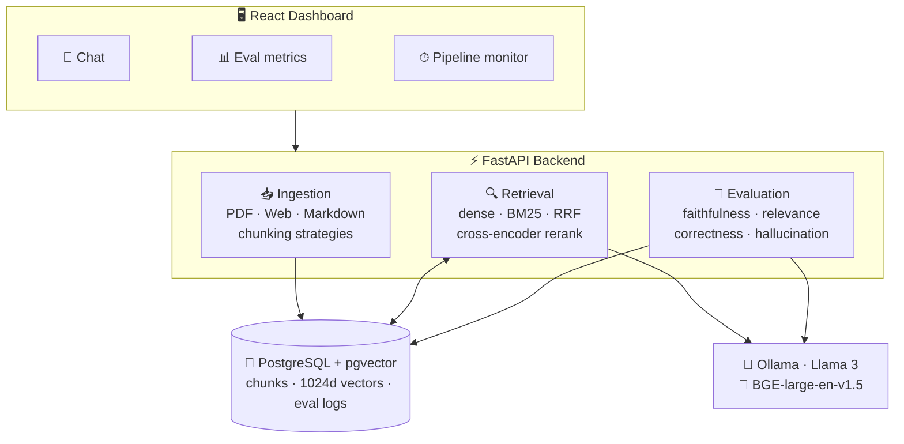
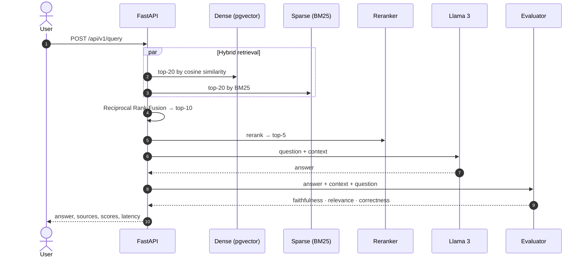

<div align="center">


<a href="#-quick-start">
  
</a>

<p>
  
  
  
  
  
</p>

<p>
  <a href="#-why-neuralforge"><b>Why</b></a> ·
  <a href="#-architecture"><b>Architecture</b></a> ·
  <a href="#-quick-start"><b>Quick Start</b></a> ·
  <a href="#-features"><b>Features</b></a> ·
  <a href="#-benchmarks"><b>Benchmarks</b></a> ·
  <a href="#-tech-stack"><b>Stack</b></a> ·
  <a href="#-roadmap"><b>Roadmap</b></a>
</p>

</div>

---

## 🧭 Why NeuralForge

> Most RAG tutorials stop at *"call an embedding model, stuff context into a prompt."*
> That's a demo, not a system.

**NeuralForge RAG** treats retrieval-augmented generation as an **engineering problem**. It doesn't just answer questions. It **measures how well** it answers them.

<table>
<tr>
<td width="50%" valign="top">

### 😐 A typical RAG demo
- 🎯 Dense search only
- 🤞 Hopes the answer is grounded
- 🙈 No idea what each step costs
- 🔒 Locked to a paid API

</td>
<td width="50%" valign="top">

### 🔥 NeuralForge
- 🔀 Dense + BM25 + cross-encoder reranking
- 📏 Faithfulness, relevance and correctness on **every** query
- 📈 Latency, tokens and cost for every step
- 🦙 Runs fully on open models (Llama 3 + BGE)

</td>
</tr>
</table>

---

## 🏗 Architecture



<details>
<summary><b>🔎 What happens during one query</b> (click to expand)</summary>



</details>

---

## 🚀 Quick Start

> **Needs:** Docker & Docker Compose · 8 GB+ RAM (Llama 3 8B quantized) · GPU optional

**1. Clone & launch**

```bash
git clone https://github.com/JackSparrow322432/neuralforge-rag.git
cd neuralforge-rag
cp .env.example .env
docker compose up -d
```

**2. Ingest documents**

```bash
# PDF
curl -X POST http://localhost:8000/api/v1/ingest \
  -F "file=@your_document.pdf" \
  -F "chunking_strategy=semantic"

# Web page
curl -X POST http://localhost:8000/api/v1/ingest/url \
  -H "Content-Type: application/json" \
  -d '{"url": "https://example.com/article", "chunking_strategy": "recursive"}'
```

**3. Ask, with evaluation**

```bash
curl -X POST http://localhost:8000/api/v1/query \
  -H "Content-Type: application/json" \
  -d '{"question": "What are the key findings?", "eval": true}'
```

<details>
<summary><b>📦 Example response</b></summary>

```json
{
  "answer": "The key findings indicate...",
  "sources": [...],
  "evaluation": {
    "faithfulness": 0.92,
    "relevance": 0.88,
    "answer_correctness": 0.85
  },
  "pipeline_metrics": {
    "retrieval_latency_ms": 45,
    "generation_latency_ms": 1200,
    "total_tokens": 847,
    "chunks_retrieved": 5,
    "chunks_after_rerank": 3
  }
}
```

</details>

**4. Open the dashboard** at **http://localhost:3000** 📊

---

## ✨ Features

<details open>
<summary><b>🔍 Hybrid Retrieval Engine</b></summary>
<br/>

| Stage | How |
|---|---|
| 🧬 Dense | pgvector + **BGE-large-en-v1.5** embeddings (1024d) |
| 📝 Sparse | **BM25** via rank-bm25 |
| 🔀 Fusion | **Reciprocal Rank Fusion** combines both result lists |
| 🎯 Rerank | Cross-encoder **ms-marco-MiniLM-L6-v2** for precision |

</details>

<details open>
<summary><b>🧪 Evaluation Engine</b>, the differentiator</summary>
<br/>

Every query is scored automatically:

| Metric | Question it answers |
|---|---|
| ✅ **Faithfulness** | Is the answer grounded in the retrieved context? |
| 🎯 **Relevance** | Are the retrieved chunks relevant to the question? |
| 💡 **Answer Correctness** | Does the answer actually address the question? |
| 🚨 **Hallucination Score** | Which claims are not in the source material? |

</details>

<details>
<summary><b>📈 Observability Dashboard</b></summary>
<br/>

- ⏱ Real-time latency: **P50 / P95 / P99**
- 🪙 Token usage monitoring
- 📉 Evaluation score trends over time
- 🔥 Retrieval quality heatmaps
- 💰 Cost estimation (tokens × model pricing)

</details>

<details>
<summary><b>✂️ Chunking Strategies</b></summary>
<br/>

| Strategy | Splits by |
|---|---|
| 🔁 Recursive | Characters, with overlap |
| 🧠 Semantic | Similarity of sentence embeddings |
| 📑 Markdown-aware | Document structure |
| 🪟 Sliding window | Fixed size, configurable overlap |

</details>

---

## 📊 Benchmarks

Tested on **100 curated question–answer pairs** across 3 document domains.

```mermaid
xychart-beta
    title "NeuralForge (first bar) vs industry average (second bar)"
    x-axis ["Faithfulness", "Relevance", "Correctness"]
    y-axis "Score" 0 --> 1
    bar [0.91, 0.88, 0.84]
    bar [0.80, 0.75, 0.70]
```



| Metric | NeuralForge | Industry avg |
|---|:---:|:---:|
| ✅ Faithfulness | **0.91** | 0.75–0.85 |
| 🎯 Relevance | **0.88** | 0.70–0.80 |
| 💡 Answer Correctness | **0.84** | 0.65–0.75 |
| 🚨 Hallucination Rate ↓ | **0.06** | 0.15–0.25 |
| ⚡ Latency P50 ↓ | **1.8 s** | 2–4 s |

<sub>Llama 3 8B Q4_K_M on a single RTX 3060.</sub>

---

## 🛠 Tech Stack

| Layer | Technology | Why |
|---|---|---|
| 🦙 LLM | Llama 3 8B via Ollama | Best open-source quality/size ratio |
| 🧬 Embeddings | BGE-large-en-v1.5 | Top MTEB scores, runs on CPU |
| 🎯 Reranker | ms-marco-MiniLM-L6-v2 | Fast cross-encoder, proven accuracy |
| 🐘 Vector DB | PostgreSQL + pgvector | Production-grade, no extra infra |
| 📝 Sparse search | rank-bm25 | Lightweight, complements dense |
| ⚡ Backend | FastAPI + Python 3.11 | Async, typed, production-ready |
| 🎨 Frontend | React + TypeScript + Recharts | Type-safe, great charting |
| 🧪 Evaluation | RAGAS + custom metrics | Industry-standard RAG evaluation |
| 🐳 Infra | Docker Compose | One-command deployment |
| 🔄 CI/CD | GitHub Actions | Automated tests and linting |

---

<details>
<summary><h2>📁 Project Structure</h2></summary>

```
neuralforge-rag/
├── src/
│   ├── api/                  # FastAPI routes & middleware
│   │   ├── main.py           # App entrypoint
│   │   ├── routes/
│   │   │   ├── ingest.py     # Document ingestion
│   │   │   ├── query.py      # Query + generation
│   │   │   └── metrics.py    # Evaluation metrics
│   │   └── middleware/
│   │       └── logging.py    # Request/response logging
│   ├── ingestion/            # loader · chunker · embedder
│   ├── retrieval/            # dense · sparse · fusion · reranker
│   ├── evaluation/           # evaluator · faithfulness · relevance · correctness
│   └── models/               # SQLAlchemy + pgvector, Pydantic schemas
├── frontend/                 # React observability dashboard
├── tests/                    # Pytest suite
├── configs/default.yaml      # Pipeline configuration
├── scripts/                  # seed_data.py · benchmark.py
├── .github/workflows/ci.yml  # GitHub Actions
├── docker-compose.yml
└── Dockerfile
```

</details>

<details>
<summary><h2>⚙️ Configuration</h2></summary>

```yaml
# configs/default.yaml
llm:
  model: "llama3:8b"
  temperature: 0.1
  max_tokens: 1024

embeddings:
  model: "BAAI/bge-large-en-v1.5"
  dimension: 1024
  batch_size: 32

retrieval:
  dense_top_k: 20
  sparse_top_k: 20
  fusion_top_k: 10
  rerank_top_k: 5
  fusion_method: "rrf"   # reciprocal rank fusion

chunking:
  default_strategy: "semantic"
  chunk_size: 512
  chunk_overlap: 50

evaluation:
  enabled: true
  metrics: ["faithfulness", "relevance", "correctness"]
  log_to_db: true
```

</details>

<details>
<summary><h2>🧑‍💻 Local Development</h2></summary>

```bash
python -m venv venv
source venv/bin/activate          # Windows: .\venv\Scripts\Activate.ps1
pip install -r requirements.txt

ollama pull llama3:8b

docker run -d --name pgvector \
  -e POSTGRES_PASSWORD=neuralforge \
  -p 5432:5432 \
  ankane/pgvector

uvicorn src.api.main:app --reload --port 8000

pytest tests/ -v --cov=src
```

</details>

---

## 🗺 Roadmap

- [x] Core RAG pipeline
- [x] Hybrid retrieval (dense + sparse)
- [x] Cross-encoder reranking
- [x] Automatic evaluation engine
- [x] Observability dashboard
- [x] Docker Compose deployment
- [ ] Streaming responses (SSE)
- [ ] Multi-modal ingestion (images, tables)
- [ ] A/B testing of chunking strategies
- [ ] Kubernetes Helm chart
- [ ] LangSmith / Phoenix integration

---

## 🤝 Contributing

Contributions are welcome. See [CONTRIBUTING.md](CONTRIBUTING.md).

## 📄 License

**MIT**: use it, fork it, ship it.

---

<div align="center">

**Built by Amanali Karatay**, AI/ML Engineer · Almaty 🇰🇿

<a href="https://github.com/JackSparrow322432"></a>
<a href="https://www.linkedin.com/in/amanali-karatay-536b712a1/"></a>

<sub>⭐ If this project helped you, give it a star</sub>


</div>
